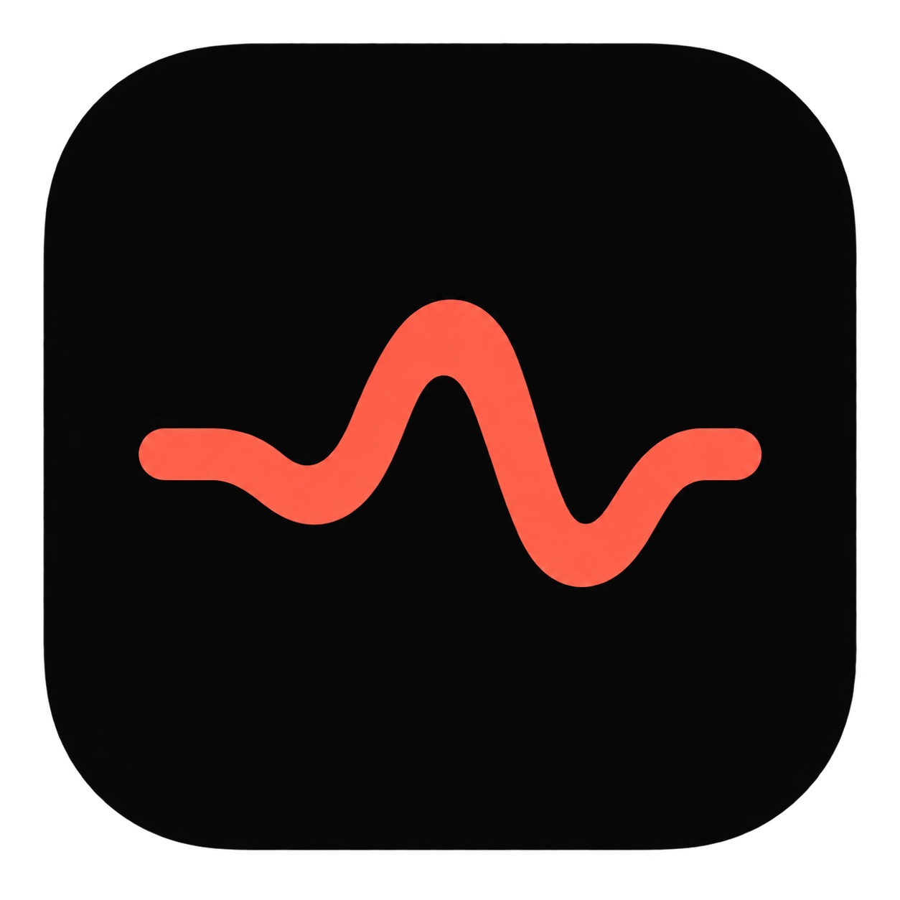

<p align="center">
  
</p>

<h1 align="center">Pulse Notch</h1>

<p align="center">
  A quiet, expandable activity surface for the MacBook notch.
</p>

<p align="center">
  Pulse Notch started as a personal tool for my own workflow: I wanted the notch
  to tell me when coding agents and GitHub Actions finished, while keeping my next
  calendar event close without adding more notification noise.
</p>

## Demo

<p align="center">
  <a href="Docs/Assets/pulse-notch-demo.mov">
    
    />
  </a>
</p>


## Installation

Install with Homebrew:

```sh
brew install --cask paugarcia32/tap/pulse-notch
```

Alternatively, download the DMG from the
[latest GitHub release](https://github.com/paugarcia32/pulse-notch/releases/latest)
and drag Pulse Notch to Applications.

Pulse Notch is ad-hoc signed and not notarized. On first launch, macOS may require
allowing it from System Settings > Privacy & Security.

To build from source:

```sh
git clone https://github.com/paugarcia32/pulse-notch.git
cd pulse-notch
./Scripts/run-app.sh
```

The script builds, ad-hoc signs, registers, and opens `.build/Pulse Notch.app`.
Launching the executable directly with `swift run PulseNotch` is not supported
because macOS cannot reliably associate privacy permissions with a standalone
SwiftPM executable.

## System requirements

- macOS 14 Sonoma or newer.
- An Apple Silicon Mac. Intel builds are not currently distributed.
- Swift 6 or newer when building from source.
- A Mac with or without a physical notch. External displays use a compact fallback.
- The GitHub CLI (`gh`) is optional and only required for GitHub activity.

## What it shows

- A prioritized summary of the next event, active work, agent usage limits, media,
  and anything that needs attention.
- Upcoming Calendar events, including meeting links and configurable reminders.
- Running and recently completed Codex, Claude Code, Cursor Agent, Antigravity,
  and OpenCode sessions.
  Codex and OpenCode subagents are grouped under their parent session; Claude Code
  subprocesses are grouped with their ancestor Claude Code process.
  Claude Code detection includes the CLI embedded in Claude Desktop; the desktop
  interface and its helpers do not count as coding sessions.
  Claude sessions count as running only when their local `~/.claude/sessions`
  registry reports `busy` for the matching live process. `idle`, `waiting`, and
  missing or unsupported state do not activate the running indicator or dynamic
  page. Long-running tasks stay active without an arbitrary inactivity timeout.
  This requires a Claude Code version that publishes session state in that registry.
  OpenCode desktop activity is detected by read-only checks of unfinished responses
  in its local session database while the app is open. Pulse Notch stores no copy;
  closing OpenCode stops detection, and no extra permission is needed.
- Open pull requests, reviews, checks, and Actions from repositories selected in
  Settings, including workflows triggered by pushes and tags.
- Active browser downloads and Homebrew operations.
- Now Playing controls, artwork, and playback progress.
- Charging, volume, brightness-key presses, and Bluetooth-headphone activities.
  Automatic display-brightness adjustments do not trigger the notch indicator.
- Stopwatch and timer activity.
- Multiple displays, Spaces, full-screen apps, keyboard shortcuts, and configurable
  collapsed indicators.

Pulse Notch is not intended to replace Notification Center. It keeps a small number
of useful, time-sensitive signals visible and stays out of the way until expanded.

## Privacy and permissions

Pulse Notch processes activity locally and does not include telemetry.

- Calendar access is requested only when Calendar features are enabled. Event data
  stays in memory and refreshes every 30 seconds.
- Coding-agent detection reads local process and session metadata, never prompts or
  conversation contents.
- Claude Code usage is read locally every 60 seconds from its CLI status line bridge
  and Claude Desktop's `plan-usage-history.json`. The newer usable source is shown.
  Desktop samples older than 15 minutes and expired CLI limits are discarded.
  No login, Keychain access, or network request is needed by Pulse Notch; without
  current data, usage is shown as unavailable.
- GitHub activity refreshes every 30 seconds through the authenticated official
  `gh` CLI and never reads or stores its token. Selected repository names are saved
  locally; removing a repository in Settings stops monitoring it.
- Downloads monitoring observes the selected local folder and can be disabled.
- Battery, Bluetooth, volume, brightness, and media state are read locally and kept
  in memory.
- When the brightness indicator is enabled, Pulse Notch listens for brightness-key
  events and reads the current brightness only after a key press. It does not store
  keystrokes. macOS may require Input Monitoring access to deliver these events
  while another app is focused; without it, the brightness indicator may not appear.
- Update checks query the public GitHub Releases API at most once per day and can be
  disabled in Settings.
- No credentials are stored by Pulse Notch.

### Claude Code local usage

For Claude Desktop, open its plan usage panel to refresh the local history. Pulse
Notch reads the latest five-hour and weekly plan percentages from that history,
without reading credentials or conversation contents. Desktop throttles history
samples to about one every 4.5 minutes, so this is recent cached usage, not a live
query. Its history has no reset timestamps, so Pulse Notch does not invent them.
Only version 2 history is currently supported; unsupported or stale history is
ignored. No copy of the Desktop history is stored by Pulse Notch.

For CLI sessions, add the following to `~/.claude/settings.json` to feed local rate
limits to Pulse Notch (merge it with your existing settings):

```json
{
  "statusLine": {
    "type": "command",
    "command": "\"/Applications/Pulse Notch.app/Contents/MacOS/PulseNotchClaudeBridge\""
  }
}
```

If you already use a custom status line, have its script pass the same JSON input
to the bridge as well as to your existing renderer. The bridge produces no visible
output and saves only rate limits to `~/.claude/pulse-notch-usage.json`, never
conversation data. Claude Code supplies subscription limits after an API response;
context-window percentages and token costs are not subscription usage. Remove the
bridge invocation to disconnect it, and delete the snapshot to remove its saved data.
Use the installed app path above rather than a development checkout path, which can
break when the repository moves. The bridge is only needed for the CLI usage source;
Claude Desktop history and active-session detection work independently of it.

Each integration can be disabled from Settings. macOS requests Calendar, Bluetooth,
or Downloads access only when the corresponding feature needs it.

## Development

Settings use an AppKit window created by `SettingsWindowController` before its
SwiftUI content is installed. This lets the sidebar and detail backgrounds extend
behind the transparent titlebar; the menu bar item and ⌘, open that window.

Build and open the app without launching it automatically:

```sh
./Scripts/run-app.sh --no-open
```

Build the ad-hoc signed release DMG and its SHA-256 checksum:

```sh
./Scripts/build-dmg.sh
```

The release artifacts are written to `dist/`.
See [Docs/RELEASING.md](Docs/RELEASING.md) for the release process.

Run the test suite:

```sh
swift test
```

The project uses Swift 6, SwiftUI, AppKit where needed, Swift Package Manager, strict
concurrency checking, and Swift Testing. Domain behavior lives in `PulseNotchCore`;
macOS UI and integrations live in `PulseNotchApp`.

## Contributing

Contributions are welcome. Please read [CONTRIBUTING.md](CONTRIBUTING.md) before
opening an issue or pull request.

## Inspiration

Pulse Notch is heavily inspired by [Alcove](https://tryalcove.com/),
[Boring Notch](https://github.com/TheBoredTeam/boring.notch), and
[Atoll](https://github.com/Atoll-Labs/Atoll). Those apps helped establish what a
native notch utility can feel like; Pulse Notch builds on that idea with the agent,
GitHub Actions, usage-limit, and workflow features that matter most to my own setup.
